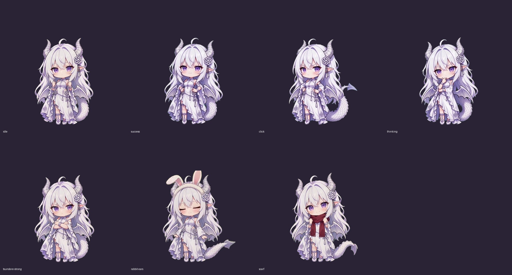

# GPT Dragon Pet · 龙娘桌宠

一个陪你写代码的 Windows 龙娘桌宠：跟随 Codex 窗口、播放动态动作，点一下看看额度，再听一句本地语音。

由 [hige6](https://github.com/hige6) 维护，基于 [T7moris/GPT-Niang](https://github.com/T7moris/GPT-Niang) 改造，使用 AI 辅助开发。Windows 挂件、窗口跟随和额度读取沿用上游；本项目增加了动态龙娘、动作调度、本地语音和便携启动。



### 能做什么

- **动态陪伴**：待机、思考、开心等动作，支持拖动、缩放和桌面模式。
- **跟随 Codex**：跟随窗口显示；可选择开启 Codex 时启动桌宠。
- **额度速览**：通过本机 Codex 的只读接口显示账号返回的额度信息。
- **本地反馈**：预录语音，以及根据本机任务事件切换工作、空闲等状态。

[查看演示视频](docs/media/dragon-experience.mp4)

### 运行

需要 **Windows 10/11 x64、Node.js 20+**。额度功能另需安装并登录 Codex CLI；动画本身不需要接入生图 API。程序使用系统自带的 Windows PowerShell 5.1 和 WPF。

1. 下载仓库 ZIP 并解压，或 `git clone https://github.com/hige6/GPT-Dragon-Pet.git`。
2. 双击 `Start-Dragon.vbs`。
3. 右键桌宠调整显示设置。需要退出时使用右键菜单。

默认数据保存在 `%LOCALAPPDATA%\GPTDragonPet\state`；启动器还会在程序目录生成本机 `installation.json`，因此请解压到可写目录。

想使用 EXE 启动器，在项目目录运行以下命令，再打开生成的 `GPTDragonPet.exe`：

```powershell
powershell.exe -NoProfile -ExecutionPolicy Bypass -File .\Build-Dragon.ps1
```

`Enable-CodexAutoStart.vbs` / `Disable-CodexAutoStart.vbs` 用于手动开启或关闭随 Codex 启动。默认不会自动配置。

### 当前边界

这是个人维护的非官方桌宠。任务状态来自本机可观察到的事件，可能覆盖多个会话；“结束”表示一轮执行结束，不代表整个任务成功。它还不能可靠识别等待审批，也不是能自由对话的 AI 角色。

程序复用 Codex 已配置的登录，通过 `codex app-server` 读取账号和额度；不会发起模型生成请求。状态模块读取本地会话事件，输出只保留状态、时间和计数，不保留聊天正文。多屏拖动、复杂窗口遮挡仍需进一步实测。

### 开发与验证

```powershell
node --test --test-concurrency=1 gpt-niang-usage/tests/*.test.mjs
powershell.exe -NoProfile -STA -ExecutionPolicy Bypass -File tests/Run-Upstream-Checks.ps1
powershell.exe -NoProfile -STA -ExecutionPolicy Bypass -File tests/Verify-Frame-Cache.ps1
powershell.exe -NoProfile -STA -ExecutionPolicy Bypass -File tests/Verify-Dragon-Behavior.ps1
powershell.exe -NoProfile -STA -ExecutionPolicy Bypass -File tests/Verify-Test-Runner.ps1
```

安装 Python 3.9+ 后，可用 `python tools/package-portable.py` 生成 `dist/` 下的便携 ZIP、文件清单与 SHA-256。打包采用文件白名单，排除本机账号和运行状态。

### 来源与许可

代码沿用 [MIT 许可](LICENSE)。GPT-Niang 原作者为 T7moris 及其贡献者；龙娘素材来自 [fywdy/chatgpt-chibi-pets](https://github.com/fywdy/chatgpt-chibi-pets)，动态帧由用户提供的视频加工而来。

**素材不适用代码的 MIT 许可。** 龙娘素材及其衍生画面保留 **CC BY-NC 4.0 非商业限制**；其他角色图像也有各自的使用说明。完整来源、固定版本与许可见 [THIRD-PARTY.md](THIRD-PARTY.md)。本项目与 OpenAI 无隶属或背书关系。
